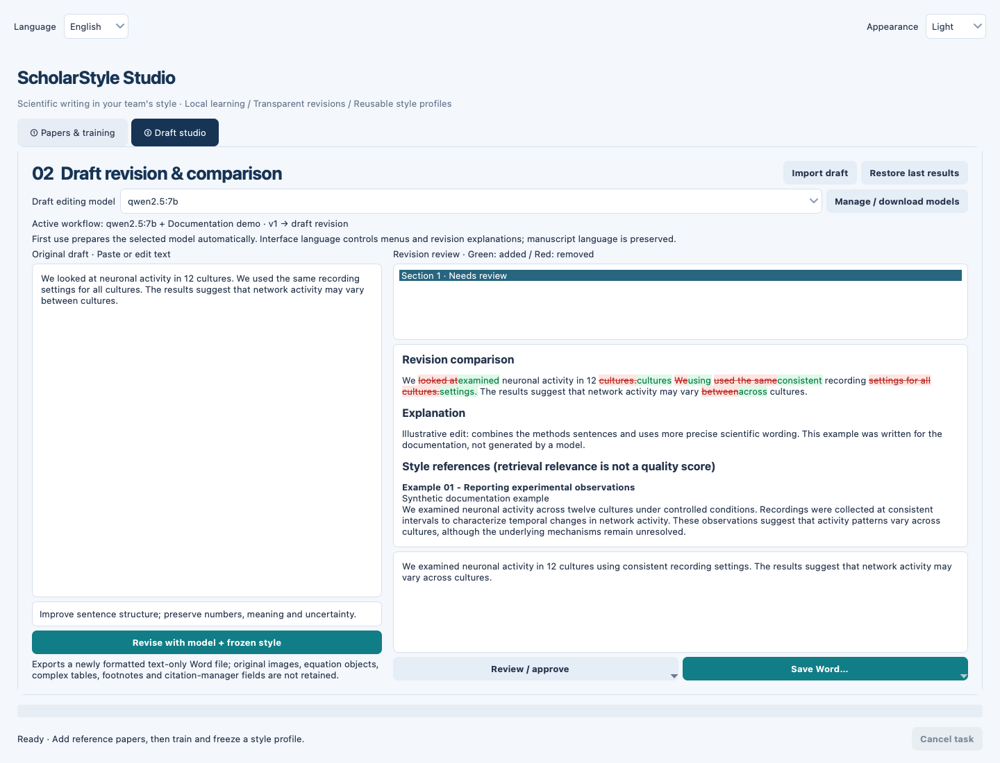
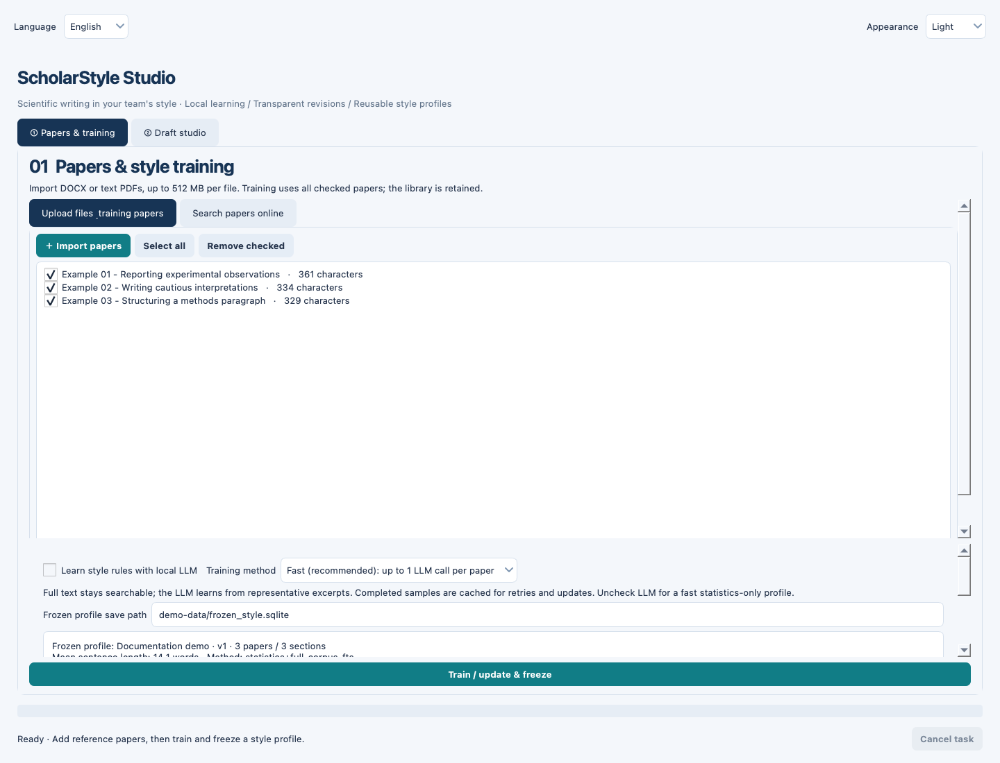
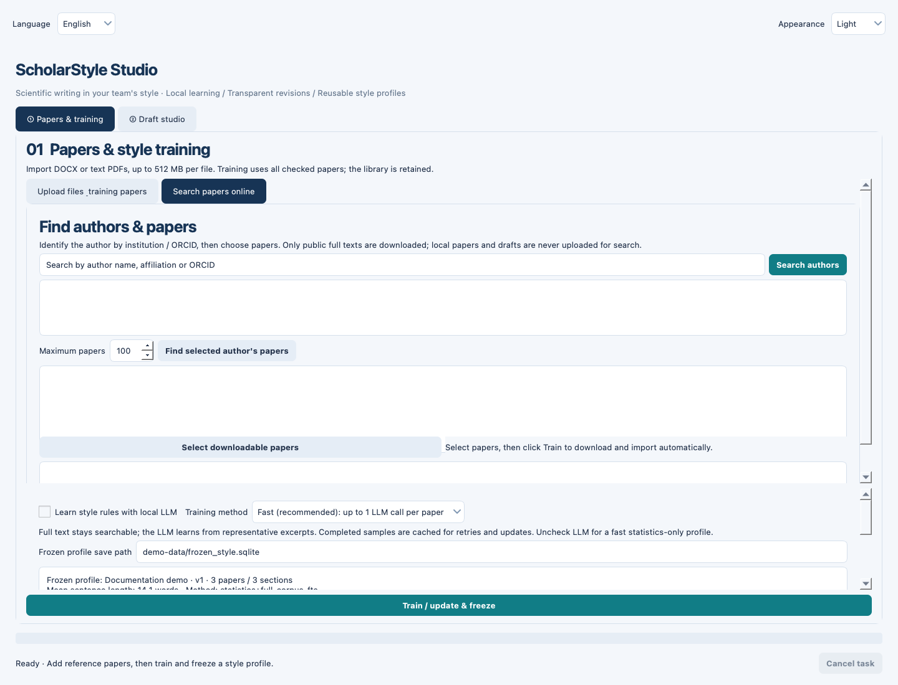
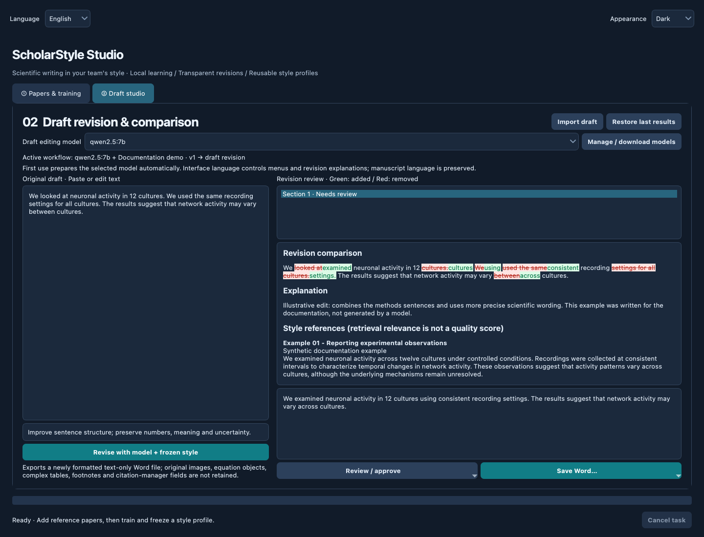
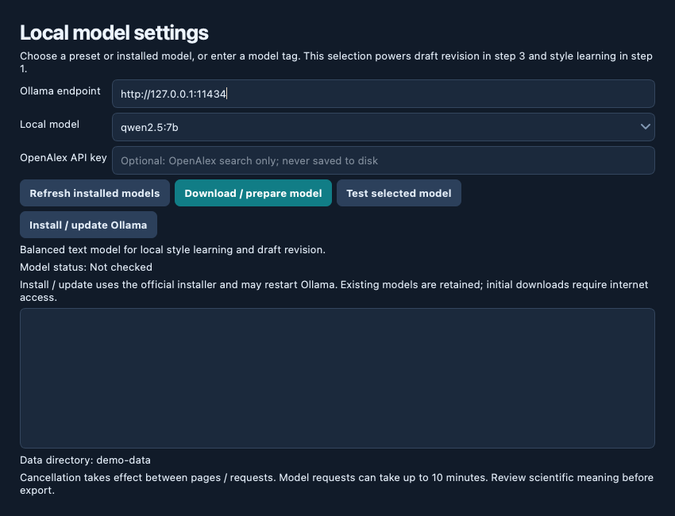

<div align="center">

# ScholarStyle Studio

**Scientific writing in your team's style — with local AI and revisions you can inspect.**

Learn from reference papers. Freeze a reusable style profile. Revise, review, and export your manuscript.


[Quick start](#quick-start) · [Workflow](#from-reference-papers-to-a-reviewed-manuscript) · [Screenshots](#a-look-inside) · [中文指南](README.zh-CN.md)

</div>



*Actual application UI, rendered with synthetic documentation data. The illustrated revision was written for this example; it is not a model-quality benchmark.*

## What it does

ScholarStyle Studio is a Python desktop application for researchers who want to make manuscript prose more consistent with a supervisor's or team's published writing. It combines reference-paper retrieval, reusable style rules, local Ollama inference, and a paragraph-by-paragraph review workflow.

| Capability | What you can do |
| --- | --- |
| Reference library | Import multiple DOCX or text-based PDF files; deduplicate extracted text and select the papers used for a profile. |
| Author discovery | Search OpenAlex, distinguish authors using affiliation and ORCID, and import available public PDFs. |
| Reusable style profiles | Combine full-corpus statistics and SQLite FTS5 retrieval with optional LLM-generated style rules. |
| Efficient style learning | Use Fast sampling (up to one LLM call per paper) or Detailed sampling (up to three); reuse cached successful analyses. |
| Local manuscript revision | Apply the selected model, frozen profile, relevant excerpts, and your editing instructions to draft sections. |
| Transparent review | Inspect red deletions, green additions, explanations, and reference excerpts; edit, approve, or keep the original. |
| Scientific consistency checks | Flag changes to numbers, citation markers, selected qualifiers, length, and newly introduced reference-text overlap. |
| Word export and recovery | Export clean or colored-comparison DOCX files after review; restore the latest saved revision session. |
| Personalization | Switch English, Deutsch, or 中文 and Light, Dark, or System appearance; keep model selections synchronized. |

**Current build:** version 0.2.0 requires **CPython 3.11**. The GUI currently loads a bundled recovery bytecode file, `scholarstyle/gui_recovery.pyc`, with editable layout customizations in `gui.py`. Most application logic is available as Python source, but the recovered GUI implementation is not yet fully restored to source. Keep this file when copying or packaging the project.

## Quick start

### 1. Install the desktop application

Use Python **3.11**, Git, and a desktop environment. The project has been tested on macOS; Windows launch scripts are included. Windows and Linux have not received full hardware-level validation.

**macOS / Linux**

```bash
git clone https://github.com/huxin0221/ScholarStyle_Studio.git
cd ScholarStyle_Studio
python3.11 -m venv .venv
source .venv/bin/activate
python -m pip install --upgrade pip
python -m pip install -e .
python launch.py
```

**Windows — Command Prompt**

```bat
git clone https://github.com/huxin0221/ScholarStyle_Studio.git
cd ScholarStyle_Studio
py -3.11 -m venv .venv
.venv\Scripts\activate
python -m pip install --upgrade pip
python -m pip install -e .
python launch.py
```

After setup, use `start.command` on macOS or `start.bat` on Windows. The installed `scholarstyle` command is also available in the active environment. In PyCharm, select this project's `.venv` interpreter and run `launch.py`.

### 2. Prepare a local model

Install [Ollama](https://ollama.com/download), start it, and prepare the default model:

```bash
ollama pull qwen2.5:7b
```

If the service is not running, run `ollama serve` in a separate terminal. The default endpoint is `http://127.0.0.1:11434`.

In **Draft studio → Manage / download models**, you can refresh installed models, prepare a model, test it with a short prompt, or install/update Ollama. Select a preset or enter an installed text-model tag. Both model selectors control the same inference engine.

Model downloads require internet access and disk space. Memory requirements and speed depend on the chosen model and context length. The app's automatic runtime installer supports macOS and Windows on the default local port; Linux and custom-port services require manual setup. The macOS installer checks for macOS 14 or later before downloading.

### 3. Make your first revision

1. Open **Papers & training** and import a few representative reference papers.
2. Keep the papers you want checked, then click **Train / update & freeze**. By default, LLM style learning is unchecked: this creates statistics and a full-text retrieval profile without model calls. Enable **Learn style rules with local LLM** to add explicit style rules.
3. Open **Draft studio**, paste a short paragraph, and optionally add an instruction such as “Improve sentence structure; preserve all numbers and uncertainty.”
4. Click **Revise with model + frozen style**.
5. Review the comparison and warnings, edit if needed, and approve the section using **Review / approve**.
6. When the full revision is complete and approved, use **Save Word…**.

## A look inside

### Reference papers and frozen profiles



Import your own documents, choose the reference corpus, and create a reusable profile. Full text remains searchable even when rule learning uses representative samples.

<details>
<summary><strong>Author discovery</strong> — search for publicly available reference papers</summary>



Search by author name, inspect affiliation and ORCID, select the correct author, and retrieve works. Select papers and train to download/import available public PDFs. Failed or unavailable full texts are reported for manual follow-up. No paywall bypass is provided.

</details>

<details>
<summary><strong>Dark appearance</strong> — the same review workflow in a dark theme</summary>



</details>

<details>
<summary><strong>Local model settings</strong> — model preparation, tests, and runtime updates</summary>



The OpenAlex API-key field is for paper discovery only. It does not configure a paid LLM API.

</details>

## From reference papers to a reviewed manuscript

### Build a representative corpus

Use clean, relevant prose from papers whose writing style you want to follow. DOCX and text-based PDF are supported; scanned PDFs need OCR first. PDF columns, headers, and hyphenation can affect extracted text. Importing stores text and source information, not copies of the original files.

For online discovery, the app queries OpenAlex and attempts available public PDFs. The search limit defaults to 100 works and can be raised to 1,000. Check author identity before importing. Access restrictions and download failures may require you to obtain a permitted copy and import it manually.

### Choose how the profile is learned

| Mode | Corpus indexed | LLM style analysis |
| --- | --- | --- |
| LLM unchecked (default) | All selected papers | None; revision can infer phrasing patterns from retrieved excerpts. |
| Fast | All selected papers | Up to one representative sample request per paper. |
| Detailed | All selected papers | Up to three sample requests per paper. |

Successful style analyses are cached by sample, training configuration, and model identity. Updating the profile uses the **currently checked corpus**, replaces the active profile only after successful completion, and retains the previous successful version. To accumulate papers, keep earlier papers selected when training again.

### Revise and review

Drafts are processed in sections of approximately 3,000 characters. Each request receives frozen rules, statistics, relevant reference excerpts, editing instructions, and a small amount of previous-section context. Interface language controls new explanations; the manuscript is instructed to retain its original language.

Review every section. You can manually edit and approve it or keep the original. Sections without warnings can be approved in a batch; flagged sections require individual attention. Editing an approved section invalidates its approval and recalculates checks.

Checks are heuristic, and model explanations can be wrong. They do not establish scientific accuracy or guarantee preservation of meaning.

### Export and recover

Export a clean DOCX or a colored comparison with additions and strikethrough deletions. **Colored comparison is not Word's native Track Changes.** Exports are newly formatted text documents; they do not preserve original images, equation objects, complex tables, footnotes, comments, or citation-manager fields. Merge approved prose into your original manuscript when its formatting matters.

Each completed section is saved to `last_revision.json`. **Restore last results** reopens saved work after restarting. An interrupted session can be reviewed but cannot be exported as a completed manuscript; rerun the full revision. Starting another revision overwrites the recovery file.

## What a “frozen style model” means

A profile contains source-attributed text chunks in a SQLite FTS5 index, corpus statistics, and up to 16 aggregated writing-style rules when LLM learning is enabled. It remains fixed during revision.

This is **retrieval and prompt-based style conditioning**. There is no gradient training, LoRA, base-model weight update, or `.pt` weight export. FTS5 performs lexical retrieval; reference relevance is not a semantic similarity or writing-quality score. Rules can depend on corpus order, and output depends on both reference quality and model behavior.

## Data and privacy

Default storage: `~/.scholarstyle-studio/`. Set `SCHOLARSTYLE_DATA` to use another directory or isolate profiles for different teams:

```bash
# macOS / Linux
SCHOLARSTYLE_DATA=./team-a-data .venv/bin/python launch.py
```

```bat
rem Windows Command Prompt
set SCHOLARSTYLE_DATA=team-a-data
.venv\Scripts\python.exe launch.py
```

| Local file | Purpose |
| --- | --- |
| `library.sqlite` | Extracted reference text and sources |
| `frozen_style.sqlite` | Active style profile |
| `frozen_style.previous.sqlite` | Previous successful profile |
| `training_cache.sqlite` | Reusable LLM style-analysis results |
| `last_revision.json` | Latest original/revised text and review state |
| `preferences.json` | Language, theme, model, and local endpoint |

Training and revision connect only to a loopback Ollama endpoint. Author searches send queries and an optional key to OpenAlex; paper downloads connect to public source URLs. Runtime/model setup may download software or model files. After setup, imported-paper workflows can run locally without a paid LLM API.

Data is stored as plaintext on your machine, with no built-in cloud synchronization or encryption. The OpenAlex key is held in memory and is not saved in preferences. Close the application before backing up the data directory; avoid multiple instances sharing it. Removing a paper from the library does not alter an existing frozen profile until you retrain.

## Troubleshooting

| Problem | What to check |
| --- | --- |
| Python version / recovery import error | Use CPython 3.11 and reinstall in `.venv`; ensure `gui_recovery.pyc` is present. |
| Cannot connect to Ollama | Start Ollama, verify the endpoint and port, then use **Test selected model**. |
| Training has no explicit rules | Enable **Learn style rules with local LLM**; the default profile uses statistics and retrieval. |
| Empty or scrambled PDF text | OCR scanned pages or import a cleaner DOCX/text-based PDF. |
| Author search or PDF download fails | Check connectivity, API access, author identity, and public full-text availability; import a permitted local file if needed. |
| Revision is slow | Try a smaller installed model and a shorter draft; model requests can take up to 10 minutes. |
| Cancel does not stop immediately | Cancellation is cooperative and checked between pages, download blocks, or model requests. |
| Word export is unavailable | Finish the entire revision and approve all sections; partial sessions are not complete manuscripts. |

Input limits are 512 MB per file, 12 million extracted characters, and 1 GB of uncompressed DOCX content. These are protective limits, not a guarantee that complex files near the limit fit every machine's memory.

## Development

```bash
python -m pip install -e '.[test]'
python -m pytest -q
python scripts/capture_screenshots.py
```

The screenshot script renders the actual Qt widgets offscreen, uses only synthetic text, and does not contact Ollama or OpenAlex. It regenerates the five images in `docs/screenshots/`.

```text
scholarstyle/
├── gui.py + gui_recovery.pyc   Desktop interface and recovery implementation
├── documents.py               DOCX/PDF extraction and Word comparison export
├── storage.py                 Corpus, frozen profiles, and FTS5 retrieval
├── training.py                Bounded sampling and style-rule aggregation
├── discovery.py               OpenAlex search and public PDF retrieval
├── llm.py                     Local Ollama requests
├── revision.py                Revision, checks, and recovery records
├── runtime.py                 Model/service preparation
├── ollama_install.py          Runtime installation and update handling
├── i18n.py                    English / German / Chinese UI strings
└── appearance.py              Light / dark / system appearance
```

The publication preparation run passed **52 tests** on macOS with CPython 3.11. These cover document handling, profile updates, sampling/cache behavior, revision checks, recovery, GUI preferences, model preparation, and launch behavior. External services and installation branches use test doubles where appropriate; this is not validation of every model or platform. See [VALIDATION.md](VALIDATION.md).

Please report reproducible issues with Python/OS versions, the model tag, and a minimal **non-confidential** example at [GitHub Issues](https://github.com/huxin0221/ScholarStyle_Studio/issues).

## License

Released under the [MIT License](LICENSE). Copyright © 2026 Billion Hu.
