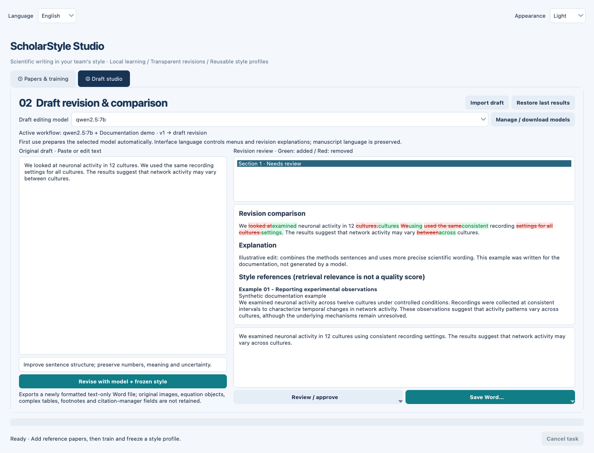
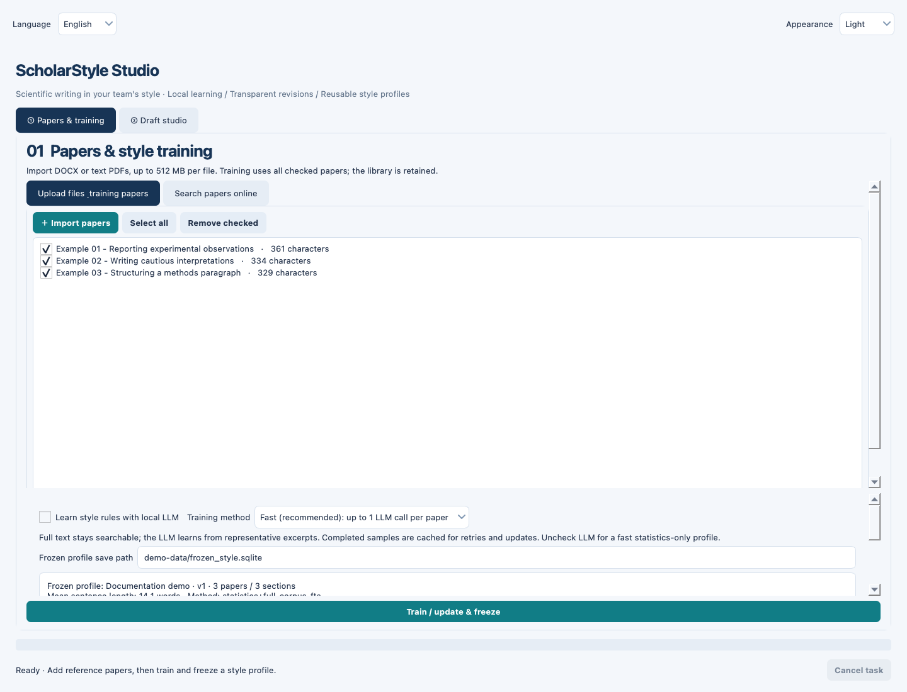
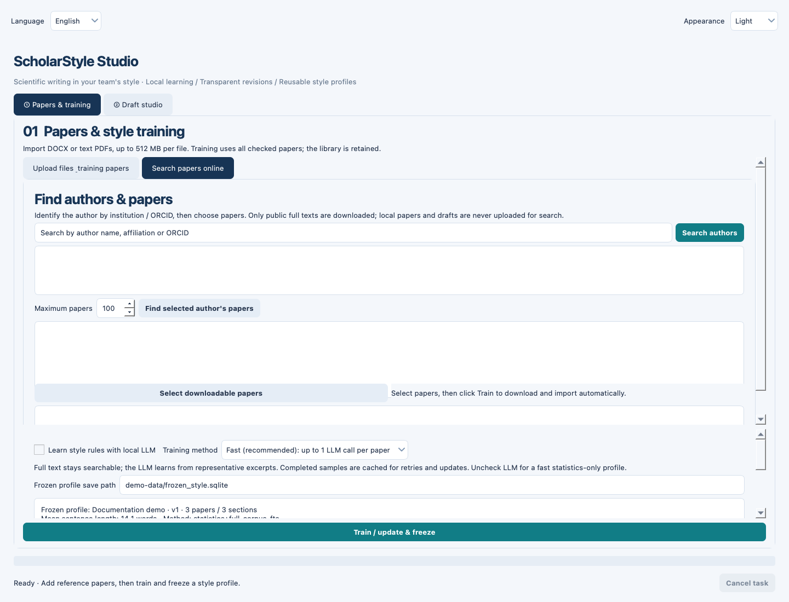
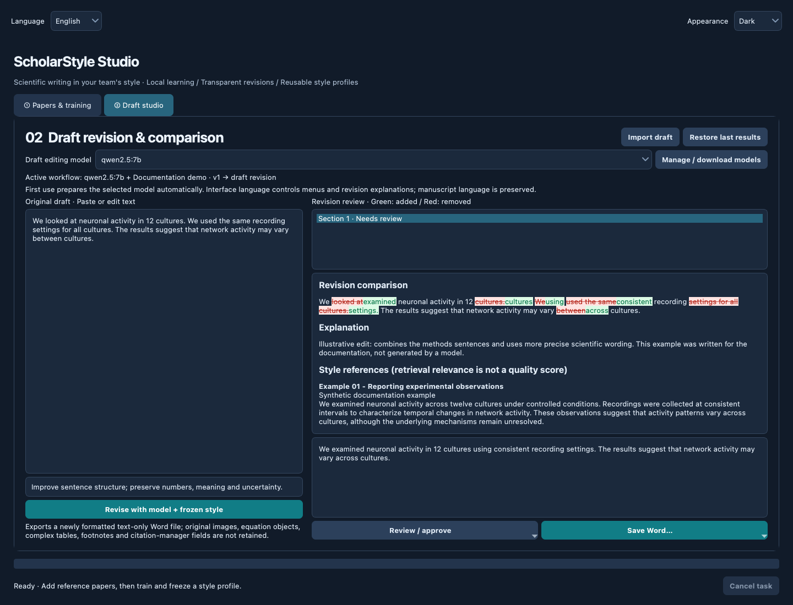
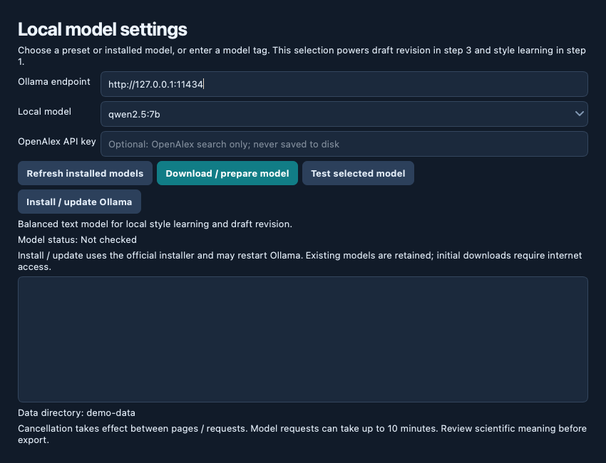

# ScholarStyle Studio

**让论文表达更贴近团队风格：本地 AI、可复用风格档案、逐段可审阅修改。**

[English](README.md) · [快速开始](#快速开始) · [使用流程](#使用流程) · [数据与隐私](#数据与隐私)



*截图来自真实 Qt 界面，仅使用合成演示文本。图中修改示例为文档人工编写，不代表模型实测效果。*

ScholarStyle Studio 是面向科研写作的 Python 桌面应用。导入导师或团队的参考论文，建立可持久化的风格档案，再使用本机 Ollama 修改草稿；每段的修改、解释和来源都可以查看、编辑与确认，最后导出 Word。

## 主要功能

| 功能 | 说明 |
| --- | --- |
| 文献库 | 批量导入 DOCX / 文本型 PDF，按文本哈希去重，勾选参与训练的论文。 |
| 作者检索 | 通过 OpenAlex 搜索作者，结合机构和 ORCID 辨认身份，获取可公开下载的 PDF。 |
| 冻结风格档案 | 保存全文词汇检索索引、语料统计，以及可选的 LLM 风格规则。 |
| 高效风格学习 | 快速模式每篇最多一次模型调用，深入模式最多三次；缓存成功分析供重试和更新复用。 |
| 本地草稿修改 | 将固定风格规则、相关参考段落、原稿和编辑要求交给所选本地模型。 |
| 可视化审阅 | 红色删除、绿色新增，显示解释和参考来源，支持手动编辑、逐段确认和保留原文。 |
| 一致性检查 | 对数值、引用、部分否定与谨慎措辞、长度及参考文字重叠进行启发式检查。 |
| 导出与恢复 | 导出干净 Word 或彩色对比 Word；恢复最近一次修改结果。 |
| 三语与主题 | English / Deutsch / 中文；Light / Dark / System；同步模型选择并保存偏好。 |

> **当前版本要求 CPython 3.11。** GUI 暂时依赖随项目提供的 `scholarstyle/gui_recovery.pyc` 恢复文件，`gui.py` 包含可编辑的布局调整。核心功能大部分提供 Python 源码，但 GUI 实现尚未完整恢复为源码；复制和打包时必须保留这个 `.pyc` 文件。

## 快速开始

### 1. 安装项目

准备 Python **3.11**、Git 和桌面环境。当前在 macOS 验证；提供 Windows 启动脚本，但 Windows / Linux 尚未完整实机验证。

**macOS / Linux：**

```bash
git clone https://github.com/huxin0221/ScholarStyle_Studio.git
cd ScholarStyle_Studio
python3.11 -m venv .venv
source .venv/bin/activate
python -m pip install --upgrade pip
python -m pip install -e .
python launch.py
```

**Windows 命令提示符：**

```bat
git clone https://github.com/huxin0221/ScholarStyle_Studio.git
cd ScholarStyle_Studio
py -3.11 -m venv .venv
.venv\Scripts\activate
python -m pip install --upgrade pip
python -m pip install -e .
python launch.py
```

以后可使用 macOS 的 `start.command` 或 Windows 的 `start.bat`。激活环境后也可运行 `scholarstyle`。PyCharm 请选择项目 `.venv` 解释器，运行 `launch.py`。

### 2. 准备本地模型

安装并启动 [Ollama](https://ollama.com/download)，下载默认模型：

```bash
ollama pull qwen2.5:7b
```

如果服务未启动，在另一个终端运行 `ollama serve`。默认地址是 `http://127.0.0.1:11434`。

进入「草稿工作室 → 管理 / 下载模型」，可以检查已安装模型、准备模型、发送短提示测试，以及安装 / 更新 Ollama。预设之外也可以输入自己的本地文本模型名称。两处模型下拉框同步，控制风格学习和草稿修改使用的推理引擎。

首次模型下载需要网络和磁盘空间；内存与速度取决于模型和上下文。自动运行环境安装支持 macOS / Windows 的默认本机端口；Linux 或自定义端口请自行配置。macOS 自动安装器会先检查系统是否为 macOS 14 或更新版本。

## 使用流程

### 第一步：添加参考论文

在「文献与训练」导入 DOCX 或文本型 PDF，勾选希望采用的论文。建议使用干净、具有代表性的正文；PDF 多栏、页眉、连字符会影响提取，扫描版需要先 OCR。



也可以在在线搜索页输入作者姓名，通过机构和 ORCID 确认作者，获取论文后勾选并训练，程序会尝试下载公开 PDF 并入库。默认最多检索 100 篇，可调至 1,000 篇。不可下载或失败的论文会提示，之后可手动导入合法获得的文件；程序不绕过访问限制。

<details>
<summary>查看作者检索界面</summary>



</details>

### 第二步：训练 / 更新并冻结

**默认不勾选「使用本地 LLM 学习风格规则」**，可直接建立全文索引和统计档案；修改时模型会结合检索到的参考片段推断写作风格。

| 模式 | 全文索引 | 风格规则分析 |
| --- | --- | --- |
| 不启用 LLM（默认） | 所有勾选论文 | 无模型调用，仅统计与检索 |
| 快速 | 所有勾选论文 | 每篇最多一次代表性片段分析 |
| 深入 | 所有勾选论文 | 每篇最多三次片段分析 |

成功分析按样本、训练配置和模型身份缓存。每次更新使用**当前勾选的完整语料**：想累积更新就保留旧论文的勾选。只有成功完成才替换活动档案，失败或取消保留原档案，并保留上一个成功版本。

### 第三步：修改草稿

在「草稿工作室」导入 DOCX / PDF，或直接粘贴文本，补充编辑要求后点击「使用模型 + 冻结风格修改」。建议首次先用一个短段落体验流程。

草稿按约 3,000 字符分块处理，每次请求包含冻结规则、统计、相关参考片段和少量前文。界面语言控制新生成的修改解释；模型被要求保留论文原语言。已有解释和规则不会随界面切换自动翻译。

### 第四步：逐段审阅

查看红绿差异、解释和来源；可以手动修改并确认本段，或选择保留原文。无警告段落可批量确认，有警告的段落需要逐段处理。修改已确认段落会取消其确认状态并重新检查。

检查与解释都不能替代科学审阅：它们不能保证事实、推理或全部语义正确，也不能保证参考措辞完全不被复制。

<details>
<summary>查看深色模式与本地模型设置</summary>





</details>

### 第五步：导出与恢复

全文修改完成并确认后，可导出干净 Word 或彩色对比 Word。彩色版使用字体颜色和删除线，**不是 Word 原生 Track Changes**。

导出是重新排版的文本稿，不保留原始图片、公式对象、复杂表格、脚注、批注或参考文献管理器字段。需要保留原格式时，请将确认后的文字合并回原始稿件。

每完成一段都会保存到 `last_revision.json`。重启后可「恢复上次结果」。中断任务可以审阅已有段落，但不能当作完整论文导出，需要重新运行全文修改；开始新的修改会覆盖恢复文件。

## “冻结风格模型”是什么？

它是一个可持久化的风格档案，包含：

- 带来源的全文段块和 SQLite FTS5 词汇检索索引；
- 高频词、平均句长等统计；
- 启用 LLM 学习时，最多 16 条汇总后的通用写作规则。

修改期间档案保持固定。这里没有梯度训练、LoRA、基础模型权重更新，也不生成 `.pt` 权重。FTS5 是词汇相关性检索，不是语义向量或作者风格质量评分。规则可能受语料顺序影响，结果取决于语料和本地模型。

## 数据与隐私

默认保存到 `~/.scholarstyle-studio/`，可用 `SCHOLARSTYLE_DATA` 为不同导师或团队指定独立目录：

```bash
# macOS / Linux
SCHOLARSTYLE_DATA=./team-a-data .venv/bin/python launch.py
```

```bat
rem Windows 命令提示符
set SCHOLARSTYLE_DATA=team-a-data
.venv\Scripts\python.exe launch.py
```

| 文件 | 内容 |
| --- | --- |
| `library.sqlite` | 提取的参考全文与来源 |
| `frozen_style.sqlite` | 当前活动档案 |
| `frozen_style.previous.sqlite` | 上一个成功版本 |
| `training_cache.sqlite` | 风格学习缓存 |
| `last_revision.json` | 最近原稿、修改稿及审阅状态 |
| `preferences.json` | 界面语言、主题、模型与本机地址 |

训练和修改仅连接 loopback Ollama；作者搜索会向 OpenAlex 发送查询及可选 API key，公开 PDF 下载会连接对应来源。安装运行环境和下载模型需要联网。准备好模型后，本地导入论文的工作流程不依赖付费 LLM API。

数据明文保存在本机，不自带加密和云同步；OpenAlex key 仅保存在内存中。请退出应用再备份数据，避免多个实例使用同一目录。删除文献库条目不会更改已经冻结的档案，需要重新训练。

## 常见问题

| 问题 | 处理方法 |
| --- | --- |
| Python 版本或 GUI 恢复文件报错 | 使用 CPython 3.11，重建 `.venv`，确保 `gui_recovery.pyc` 存在。 |
| Ollama 无法连接 | 启动服务，检查地址和端口，在设置中测试模型。 |
| 档案没有风格规则 | 默认只建立统计与检索；勾选 LLM 学习后重训。 |
| PDF 无文字或顺序混乱 | 对扫描页 OCR，或换用干净 DOCX / 文本型 PDF。 |
| 作者搜索或全文下载失败 | 检查网络、API 访问、作者身份和公开全文可用性，必要时手动导入。 |
| 修改慢、取消不立即结束 | 尝试较小模型；取消在页、数据块或请求之间检查，单次模型请求可能持续至 10 分钟。 |
| 不能导出 | 确认全文修改完成并已审阅所有段落，部分结果不能作为完整论文导出。 |

单文件上限 512 MB、提取文字上限 1,200 万字符、DOCX 解压总量上限 1 GB。这是保护上限，不代表所有复杂文件在低内存设备上都能处理。

## 开发与验证

```bash
python -m pip install -e '.[test]'
python -m pytest -q
python scripts/capture_screenshots.py
```

发布准备时在 macOS / CPython 3.11 上 **52 项测试通过**。测试涵盖文档处理、档案更新、采样与缓存、修改检查、恢复、GUI 设置、模型准备和启动器；外部服务与安装分支按需使用模拟，并不代表所有模型及平台均已实测。详见 [验证记录](VALIDATION.md)。

截图脚本使用真实 Qt 控件离屏渲染，仅生成合成演示数据，不连接 Ollama 或 OpenAlex。代码模块说明见[英文 README](README.md#development)。

反馈问题时，请在 [Issues](https://github.com/huxin0221/ScholarStyle_Studio/issues) 附上系统、Python 版本、模型名称和不含机密信息的最小示例。

## 许可

本项目采用 [MIT 许可证](LICENSE)。Copyright © 2026 Billion Hu。
